[**View portfolio ↗**](https://karim-mohamed-portfolio.pages.dev/)　·　[Download CV](https://karim-mohamed-portfolio.pages.dev/assets/Karim-Mohamed-CV.pdf)　·　[LinkedIn](https://www.linkedin.com/in/karim-mohamed-mahmoud/)　·　[Email](mailto:dev.karim12@gmail.com)

I’m Karim, a backend developer at **Digital Vibes** in Cairo. I write the Laravel code that gets an order from checkout to a driver’s phone, brings a new lead into the right sales team’s CRM, and keeps track of campaigns across ad platforms.

## Behind the products

### DV Ads Manager

I built most of the campaign backend. I connected **Meta, Snapchat, and TikTok** so advertisers could create campaigns, follow their status, and monitor their ad accounts in one place.

[**Case study ↗**](https://karim-mohamed-portfolio.pages.dev/dv-ads-manager) · [Website](https://www.dvadsmanager.com/en) · [iOS](https://apps.apple.com/us/app/dv-ads-manager/id6450996107) · [Android](https://play.google.com/store/apps/details?id=com.dv.ads.manger)

 

### Makook

I designed the APIs behind a marketplace handling **300+ orders a day across 100+ active vendors**. I built checkout, driver assignment, and live tracking so customers, shops, and drivers could follow the same order.

[**Case study ↗**](https://karim-mohamed-portfolio.pages.dev/makook) · [iOS](https://apps.apple.com/eg/app/makook/id6757299626) · [Android](https://play.google.com/store/apps/details?id=com.eg.makook)

 

### Happy Texting

I refactored the messaging backend, integrated **Twilio and Bird (MessageBird)** as SMS providers, and built the proxy service for both text messages and voice calls.

[**Case study ↗**](https://karim-mohamed-portfolio.pages.dev/happy-texting) · [Website](https://happytexting.com/) · [iOS](https://apps.apple.com/us/app/happy-texting/id1662338101) · [Android](https://play.google.com/store/apps/details?id=com.happytexting.www)

 

### Vetray

I built the backend that assigns veterinary cases to specialists, connects them with pet owners over real-time chat, and settles their commissions. The platform handled **500+ paid consultations**, with Stripe payments in USD and AED.

[**Case study ↗**](https://karim-mohamed-portfolio.pages.dev/vetray) · [Website](https://vetray-consultancy.com/)

 

### Connect

I designed the **multi-tenant CRM** and connected Meta, WhatsApp Business, and TikTok. Incoming leads enter the right company’s pipeline, with separate data, roles, and Stripe subscriptions for each tenant.

[**Case study ↗**](https://karim-mohamed-portfolio.pages.dev/connect) · [Web app](https://web.dvconnect.info/)

 

### i-Makeup

My work on this beauty store covered **checkout payments and email**. I also traced bugs in the existing application and improved storefront performance.

[**Case study ↗**](https://karim-mohamed-portfolio.pages.dev/i-makeup) · [Storefront](https://i-makeup.com/en/)

 

### Operation MSP

I converted the existing Laravel application to a **multi-tenant system**, refactored the backend, and improved performance. I also worked on payments and the CRM where sales reps record activities using forms their admins define.

[**Case study ↗**](https://karim-mohamed-portfolio.pages.dev/operation-msp) · [Website](https://operationmsp.com/)

 

## Tools I work with

| | |
| :--- | :--- |
| **Application** | PHP · Laravel · REST APIs · webhooks · Laravel Passport · JWT |
| **Data & background work** | MySQL · Redis · Elasticsearch · Laravel queues |
| **Delivery & testing** | Docker · Linux · Git · CI/CD · unit testing |

For a closer look at an implementation, [explore the project walkthroughs](https://karim-mohamed-portfolio.pages.dev/#work) or [get in touch](mailto:dev.karim12@gmail.com).
